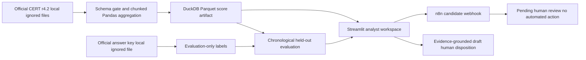

# Architecture

The model is Isolation Forest trained only on the first 75% of time. Labels are excluded from feature selection and model fitting. The answer key is joined only after scores are generated for benchmark evaluation.
